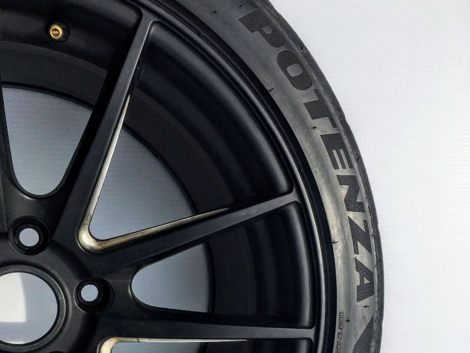
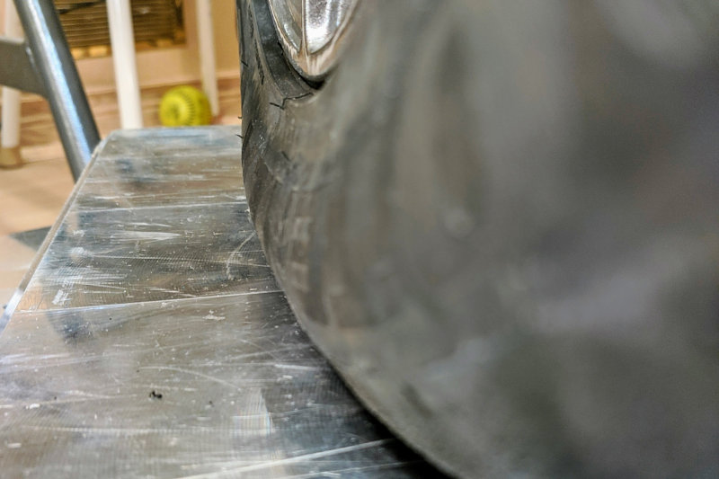

<link rel="stylesheet" href="https://fonts.googleapis.com/icon?family=Material+Icons">

    info
    

    This article was prepared for <i>Formula Delta</i> to demonstrate new tire
    footprint and vertical stiffness testing capabilities. The original version
    of this article can be found <a
    href="https://formuladelta.ca/blog/2021/07/18/measuring-the-tire-vertical-stiffness-of-a-255-40r17-bridgestone-potenza-re-71r/">here</a>.
    

Managing the relationship between the tire and the vehicle is an important
element of vehicle handling. The tire is the vehicle's interface with the road
and must work with the suspension system to support the vehicle weight.

The tire vertical stiffness is a property that can be helpful in evaluating tire
performance. While it is not an indicator of its grip capabilities, it will
affect the vertical dynamics of the vehicle. To demonstrate the applicability of
this property, we take a popular 200TW ultra-high performance tire and measure
its vertical stiffness. This tire is the Bridgestone Potenza RE-71R 255/40R17
98W.

## Tire load-deflection

The tire is an elastic element that acts in series with the springs to modify
the overall ride rate of the vehicle. Just like an ordinary coil spring, the
tire vertical stiffness can be computed from a load-deflection curve.

Tire load-deflection curves are obtained by exercising the tire through a range
of vertical loads. The tire is compressed into a flat plate where the tire
vertical load and radial deflection are measured. The tangent of the
load-deflection curve at a specific point is the tire vertical stiffness.

$$
K_{Z} = \frac{dF_Z(R_l)}{dR_l} \Bigg|_{F_{Z}=x}
$$

Where:

- $K_Z$ is the tire vertical stiffness [N/mm]
- $F_Z$ is the tire vertical load [N]
- $R_l$ is the tire loaded radius [mm]
- $x$ is the tire vertical load where the vertical stiffness is evaluated [N]

Testing was performed by [_Formula Delta_][1] using their tire vertical
stiffness testing fixture. The tire vertical stiffness testing capabilities of
the [_Formula Delta_][1] tester are shown in the table below.

| Parameter                   | Value   |
| --------------------------- | ------- |
| **Vertical load, max** [N]  | 6675    |
| **Loaded radius, max** [mm] | 375     |
| **Tire width, max** [mm]    | 400     |
| **Inclination angle** [deg] | 0, 2, 4 |
| **Bolt pattern**            | 5x114   |

## Test schedule

The tire under test is a used Bridgestone Potenza RE-71R 255/40R17 98W.
Released in North America in 2015, the Bridgestone Potenza RE-71R is a popular
choice for enthusiasts in the ultra-high performance tire segment. This makes it
a good representation of a typical 200TW tire.

Testing is performed in a temperature controlled environment. The test
conditions are summarized in the table below.

| Parameter                      | Conditions         |
| ------------------------------ | ------------------ |
| **Ambient temperature** [degC] | 17                 |
| **Tread depth** [mm]           | 4.5                |
| **Vertical load, max** [N]     | 6230               |
| **Inflation pressure** [PSI]   | 24, 27, 30, 33, 36 |
| **Inclination angle** [deg]    | 0, 2, 4            |

Measurements are taken during both loading and unloading conditions. The data is
fit to a second degree polynomial using least-squares regression. Values are
referenced using the SAE tire coordinate system.

## Analysis

We start the analysis by looking directly at the measured tire load-deflection
curves. The figure below shows the load-deflection curves across all test
conditions and includes a _composite_ curve showing the _average_ response.

<html lang="en">
<head>
<meta charset="utf-8">
<title>Bokeh Plot</title>

</head>
<body>

</body>
</html>

We can already observe the influence of inflation pressure and inclination angle
just by inspecting the load-displacement curves. The change in unloaded radius
due to the inclination angle is primarily an artifact of the SAE tire coordinate
system. However, between inclination angles you can see how the unloaded radius
grows with inflation pressure. With vertical load, there is even more variation
between the conditions.

The tire vertical stiffness can be computed from the load-displacement curves at
a specific vertical load. We have chosen a reference vertical load of 3560 N to
measure the vertical stiffness. The results of the analysis are shown in the
figure below. For reference, the tire vertical stiffness measured from the
_composite_ load-displacement curve is 252.1 N/mm.

<html lang="en">
<head>
<meta charset="utf-8">
<title>Bokeh Plot</title>

</head>
<body>

</body>
</html>

The influence of inflation pressure and inclination angle on vertical stiffness
is more apparent in this analysis. As the inflation pressure increases, the tire
vertical stiffness increases. This relationship is observed across all
inclination angles. Increasing the inclination angle from 0 deg to 2 deg
decreases the vertical stiffness by 5.5% on average. However, increasing the
inclination angle from 2 deg to 4 deg does not have the same effect. On average,
the vertical stiffness is reduced by 1%, with only the 33 PSI condition showing
an increase in vertical stiffness.

## Final comments

In this study, we measured the vertical stiffness of the Bridgestone Potenza
RE-71R 255/40R17 98W tire under different inflation pressure and inclination
angle conditions. We found that the vertical stiffness at 3560 N can vary from
215.6 N/mm to 292.7 N/mm depending on the conditions. The influence of inflation
pressure on vertical stiffness is observed at all inclination angles. It is less
clear how inclination angle affects the tire vertical stiffness. At reference
load, there is an overall reduction of ~5.5% in tire vertical stiffness when the
inclination angle goes from 0 deg to 2 deg. However, increasing the inclination
angle from 2 deg to 4 deg did not have the same effect.

The tire is an elastic springing element in the suspension system that cannot be
ignored. Understanding the relationship between the tires and the chassis
affords you better tuning control over the ride and the lateral load transfer
distribution. With manufacturers being opaque with the technical data of their
products, laboratory tire tests represent one way to gain insight into tire
performance. The vertical stiffness test can be repeated with several tires to
provide insight into how tire manufacturers are differentiating their products,
especially in today's competitive enthusiast tire market.

## Acknowledgements

This analysis is possible thanks to **Ping Zhang** at [_Formula Delta_][1].
This analysis required considerable amount of design, manufacturing and testing
support. You can learn more about [_Formula Delta_][1] on [Facebook][2] and
[Instagram][3]!

## References

1. Gent, A. N., & Walter, J. D. (2006). Pneumatic tire.
1. Milliken, William F., and Douglas L. Milliken. _Race car vehicle dynamics_. Vol. 400. Warrendale: Society of Automotive Engineers, 1995.

[1]: https://formuladelta.ca/
[2]: https://www.facebook.com/FormulaDeltaConsult
[3]: https://www.instagram.com/formula.delta/
